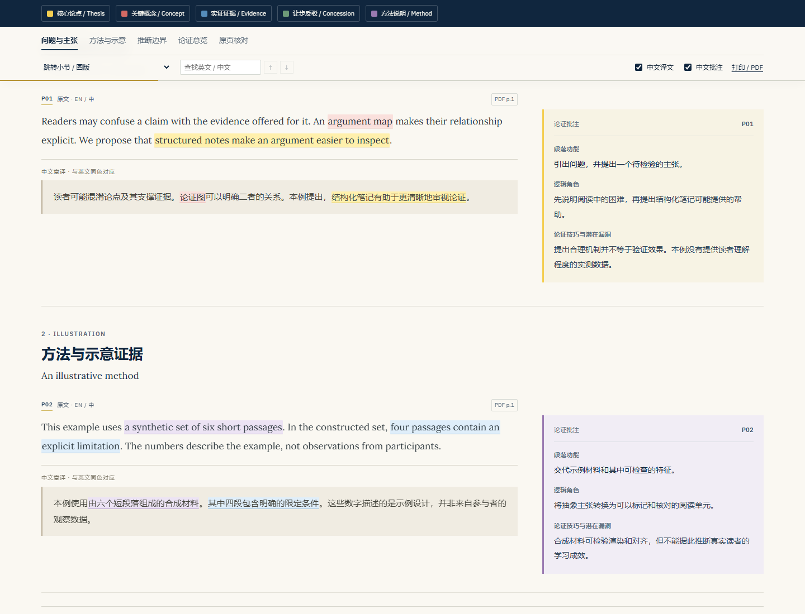

# PaperLens · 论文透镜

把学术论文读成一条可以核查的论证链。

PaperLens 是一个可复用的 Codex Skill：将用户提供的论文制作成单文件 HTML，左栏是英文原文和中文意译，右栏是逐段中文论证批注。高亮在英中两边同步对应，图文沿用原论文的出现顺序。



## 可以得到什么

- **逐段英中对照**：保留英文原文，紧接流畅中文意译。
- **中文论证批注**：逐段说明功能、逻辑角色、论证技巧及潜在漏洞，区分直接观察、作者推断和待检验主张。
- **双语同步五色高亮**：黄色论点、红色概念、蓝色证据、绿色让步/反驳、紫色方法；开关同时控制英中对应内容。
- **图文按原文顺序穿插**：保留完整图注和实际提供的补充材料，不把主图统一挪到文末。
- **持续可见的图例**：章节导航与五色图例一起吸顶，手机上五类颜色也全部可见。
- **全文论证总览**：问题→论点→证据→反驳/让步→结论，附一句话主张和最强、最弱论证。
- **单文件离线阅读**：字体、图片、样式和交互内嵌；支持查找、图版放大、原页核对及打印。

## 安装并调用

将本仓库放入个人 Codex skills 目录，文件夹命名为 `paperlens`。

macOS / Linux：

```sh
git clone https://github.com/howardhyx/paperlens.git ~/.codex/skills/paperlens
```

Windows PowerShell：

```powershell
git clone https://github.com/howardhyx/paperlens.git "$env:USERPROFILE\.codex\skills\paperlens"
```

如果设置了 `CODEX_HOME`，使用该目录下的 `skills/paperlens`。不要覆盖已有的同名 Skill。

在支持本地 Skill 的 Codex 会话中使用：

```text
使用 $paperlens 将这篇论文制作成完整双栏批注 HTML。
沿用固定字体与配色，保留全文，使用中文批注、双语同步高亮及原文图文顺序。
论文路径：你的论文.pdf
```

Skill 入口：[SKILL.md](SKILL.md)。它指导智能体阅读、翻译、分析并整理内容；渲染器本身不调用模型，也不会自动完成翻译。

## 先试运行示例

示例是专为本项目编写的合成阅读材料，不摘录任何学术论文，也不报告真实实验结果。

生成 HTML 仅需 Python 3.10 或更高版本，渲染器使用标准库：

```sh
python scripts/render_reader.py examples/minimal.json demo.html --report demo-report.json
```

随后用浏览器打开 `demo.html`。生成文件已内嵌字体和图像，可离线阅读。

处理自己的材料时，先由智能体按[数据格式](references/input-schema.md)整理 JSON，再运行同一命令。输入中的图片路径相对于 JSON 文件所在目录；也支持内嵌图像。渲染器检查顺序、原文与译文配对、中文批注及双语高亮对应。

## PDF 检查与浏览器验收

可选 PDF 检查工具需要 `pdfplumber` 和 `Pillow`：

```sh
python -m pip install pdfplumber Pillow
python scripts/inspect_pdf.py your-paper.pdf work/source --render
```

它输出逐页文本、行坐标、图像和联系表，不擅自猜测双栏阅读顺序，也不把低文本量页面直接认定为扫描件。

运行标准库测试：

```sh
python -m unittest discover -s tests -v
```

浏览器检查器需要本地 Playwright 与浏览器。默认寻找已安装的 `playwright`，也可传入实际包路径：

```sh
node scripts/check_reader.cjs demo.html --screenshots work/browser-check
```

使用系统浏览器或特定依赖目录时，增加 `--browser 浏览器可执行文件路径`、`--playwright Playwright包路径`。完整验收标准见[检查清单](references/quality-checks.md)。

## 固定视觉风格

| 元素 | 设定 |
|---|---|
| 页头 | 深海军蓝 `#10263e` |
| 纸张 | 米白 `#faf8f2` |
| 中文译文块 | 浅米色 `#f0ece2` + 左竖线 |
| 英文正文 | Lora |
| 界面、中文译文与批注 | IBM Plex Sans，中文使用系统回退字体 |
| 桌面布局 | 左右约 2.15:1，逐段成行 |
| 手机布局 | 原文→译文→该段批注 |

## 项目结构

```text
SKILL.md                 智能体入口与固定规范
agents/openai.yaml       Skill 显示名称与调用提示
assets/                  阅读器样式、交互、模板和字体
scripts/render_reader.py 单文件 HTML 渲染
scripts/inspect_pdf.py   PDF 文本坐标与预览
scripts/check_reader.cjs 浏览器验收
references/              数据格式及质量检查
examples/                原创合成示例
tests/                   渲染与校验测试
```

## 许可与内容来源

本项目原创代码、说明和示例采用 [MIT License](LICENSE)。随附的 Lora、IBM Plex Sans 字体分别采用 SIL Open Font License 1.1，原许可和版权声明均予以保留，见[第三方说明](THIRD_PARTY_NOTICES.md)。

输入论文及其中图片的权利不因使用本工具而改变。生成的翻译、批注与原页图像是否适合公开发布，需要依据材料本身的授权范围判断。本仓库不包含用户论文、真实论文批注成品、私人路径或会话记录。
